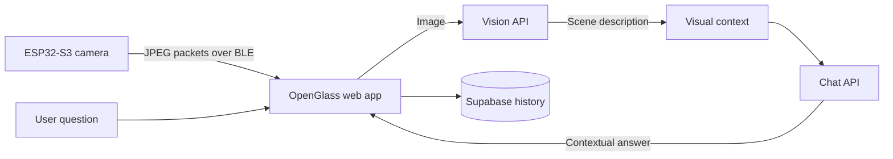

<p align="center">
  <a href="https://github.com/rahulcvwebsitehosting/OpenGlass">
    
  </a>
</p>

<h1 align="center">OpenGlass AI</h1>

<p align="center">
  <strong>Affordable smart glasses with scene descriptions, capture history, and contextual answers.</strong><br>
  Built by <a href="https://github.com/rahulcvwebsitehosting">Rahul Shyam</a> as an open, hackable hardware and software project.
</p>

<p align="center">
  <a href="https://rahulshyam-portfolio.vercel.app/"><strong>Portfolio</strong></a> ·
  <a href="https://github.com/rahulcvwebsitehosting/OpenGlass/issues">Report a bug</a> ·
  <a href="https://github.com/rahulcvwebsitehosting/OpenGlass/issues">Request a feature</a>
</p>

## About the project

OpenGlass AI turns an inexpensive pair of glasses into a wearable visual assistant. An ESP32-S3 camera captures the scene, sends photos to the browser over Bluetooth Low Energy, and uses vision and chat models to describe what is happening and answer questions about recent captures.

With an optional, separately configured Supabase project, the companion app can also store photos, descriptions, and question-and-answer history. Live capture and Q&A work without history storage.

## Highlights

- Live photo capture from the XIAO ESP32-S3 Sense over Web Bluetooth
- Automatic scene descriptions powered by a vision model
- Typed natural-language questions answered from recent visual context
- Photo, caption, and Q&A history backed by Supabase
- Browser-based Expo and React Native interface
- Server-side API proxies that keep model provider keys out of the client bundle
- Arduino firmware for camera capture and BLE, with optional microphone characteristics
- Hardware build based on readily available components

## System flow



## Technology

| Layer | Technology |
| --- | --- |
| Companion app | Expo, React Native, TypeScript |
| Device connection | Web Bluetooth / BLE |
| Hardware | Seeed Studio XIAO ESP32-S3 Sense |
| Firmware | Arduino C++ and ESP32 camera libraries |
| AI integration | OpenAI-compatible vision and chat APIs |
| Storage | Supabase Database and Storage |
| Hosting | Vercel serverless functions and static web export |

## Hardware to buy

**Reference controller: [Seeed Studio XIAO ESP32-S3 Sense, SKU 113991115](https://www.seeedstudio.com/XIAO-ESP32S3-Sense-p-5639.html), 8 MB flash + 8 MB PSRAM.** Buy the complete **Sense** kit, preferably without soldered pin headers for a compact mount. Confirm the seller includes the Sense camera/microphone expansion board, camera, 2.4 GHz antenna and heat sink. A bare XIAO ESP32-S3, ESP32-CAM, S3 Plus or loose generic camera is not a drop-in replacement for this build.

### Minimum working bench prototype

| Buy / provide | Qty per prototype | Required specification / purpose |
| --- | --- | --- |
| Complete XIAO ESP32-S3 Sense kit | 1 | Includes the controller, camera/microphone daughterboard and camera. Current stock may be OV5640 AF or OV3660; see the camera note below. |
| 2.4 GHz antenna with the correct board connector | 1, normally in the kit | Fit the supplied antenna to the Wi-Fi/Bluetooth antenna socket. Do not order another if included. |
| Sense-compatible heat sink and thermal attachment | 1 set, normally in the kit | Retain the supplied cooling parts and room for airflow. Keep metal clear of battery pads and exposed conductors. |
| USB-C **data** cable | 1 | For firmware upload and USB-powered testing. A charge-only cable cannot upload firmware. |
| Existing computer with Bluetooth LE | 1, reuse | Flashing requires a computer. Use current Chrome/Edge on a supported OS, with Bluetooth enabled. Windows 10/11 or macOS is the simplest desktop starting point. |

**Start with USB power; a battery is not required to prove camera → BLE → browser → AI.** Use a reliable USB source; a regulated 5 V / 1 A source is a sensible bench supply if the computer port cannot keep capture stable. Do not buy a USB-to-UART adapter: the board provides native USB programming.

### Add these for a battery-powered wearable

| Buy / provide | Qty | Selection requirement |
| --- | --- | --- |
| Protected rechargeable LiPo pack | 1 | **1S, 3.7 V nominal, 4.2 V full-charge**, with overcharge, overdischarge and short/overcurrent protection and pre-attached leads. A **500–1000 mAh** pack is a starting capacity range, not a fit or runtime guarantee. For a conservative purchase, require a documented **at least 1 A continuous discharge rating** and an allowed charging current **at least 150 mA**. A 500 mAh pack therefore needs at least a 2C continuous rating. Capacity alone does not establish suitability. |
| Two-position power switch | 1 | SPST, or SPDT using common + one throw; rated **at least 1 A at 5 V DC**. Install in the positive battery lead. This switches the battery path; USB can still power the board. |
| Insulated flexible wire and matching battery connector pigtail | 1 small set | Short 26–28 AWG leads rated for the load, strain relief, and a connector matching the selected pack. The board has solder pads for the battery; it does not provide a JST battery socket. Verify polarity electrically rather than trusting connector shape or wire colour. |
| Electrical insulation and strain relief | 1 small set | Suitable insulating film/heat-shrink and cushioned restraint; protect the pouch from screws, sharp edges, compression and hot electronics. |
| Glasses frame + fitted enclosure/mount | 1 set, reuse frame if suitable | Fit the **actual** camera revision, antenna, heat sink, battery protection board, leads, switch and USB access before fabrication. Fastener sizes/lengths depend on that final mount; no universal screw count is approved. |

The **1 A discharge / 150 mA charge requirements are conservative selection margins**, not measured consumption or charging current for this firmware. Seeed documentation spans board/camera revisions; confirm the exact seller datasheet. Do not substitute a 4.35 V high-voltage cell, LiFePO4 cell, 2S pack or unprotected bare pouch.

**No exact battery part number or finished enclosure is qualified yet.** Earlier project CAD used a proposed **6 × 35 × 15 mm battery-body envelope** and May 2023 electronics geometry. That excludes many ordinary 500–1000 mAh packs and omits allowances for their protection board/connector. Resize the mount around a selected, documented pack; do not buy a cell merely because its nominal voltage matches. See the [power, fit and thermal audit](docs/hardware-audit.md).

You need access to a soldering iron, solder, multimeter and a way to measure surface temperature for assembly/qualification; these are workshop tools, not extra modules in each pair of glasses. A 3D-printing service can supply the mount. Buy a separate USB power supply only if you do not already have a suitable one.

### Camera and software compatibility

Seeed has replaced the original OV2640 with OV3660 and then OV5640 AF in different batches. All three sensor drivers are enabled in the pinned ESP32 core. The firmware now initializes **OV5640 autofocus**, applies the manufacturer's drive-strength adjustment and configures OV3660 orientation before switching to **640 × 480 JPEG**. Install the pinned AF library described in [firmware/readme.md](firmware/readme.md), including for fixed-focus builds. These changes provide a source-compatible path for current Sense kits; they do not replace a focus/capture test on the delivered unit.

The complete current product is **periodic scene photos and typed Q&A in a browser**. AI inference runs through server APIs and needs internet access on the companion device. The ESP32 sends photos over BLE and does not need Wi-Fi credentials. Android Chrome is an additional Web Bluetooth option subject to device/browser testing; keep the page in the foreground. Safari/iOS and native Expo apps do not implement the current capture path. The hardware does not provide a display, spoken answers, offline AI or voice questions.

### Do not add these to the current build

| Item | Why it is unnecessary for this code |
| --- | --- |
| Separate camera, microphone or BLE module | Already part of the complete Sense kit; no extra sensor wiring is used. |
| microSD card | Firmware streams JPEGs through BLE and does not initialize SD storage. |
| TP4056 or other charger, boost converter, battery gauge | The board charges a compatible 1S pack over USB; no external charger/converter/gauge is required by this design. A charger does **not** replace pack protection. Battery percentage is not implemented. |
| Speaker, bone-conduction driver, amplifier, display, GPS, IMU, extra MCU/Raspberry Pi | No implemented feature uses them. They require a new power/wiring/software design. |
| Breadboard, Grove base, pin-header kit | Optional bench conveniences; unnecessary for the assembled Sense camera and direct battery-pad wiring. |

The BLE contract includes photo notifications, photo control, optional audio and device information. It has **no battery-level service**. The camera keeps running while powered; the capture stop command is not a hardware power switch or a deep-sleep mode.

For the full code-to-hardware mapping and physical test gates, read [docs/hardware-audit.md](docs/hardware-audit.md).

## Getting started

### 1. Install the app

Use Node.js 22 and the committed npm lockfile.

```bash
git clone https://github.com/rahulcvwebsitehosting/OpenGlass.git
cd OpenGlass
npm ci
```

### 2. Configure environment variables

Copy `.env.template` to `.env` and add your service credentials:

```env
EXPO_PUBLIC_SUPABASE_URL=
EXPO_PUBLIC_SUPABASE_ANON_KEY=

VISION_API_KEY=
VISION_BASE_URL=
VISION_MODEL=

CHAT_API_KEY=
CHAT_BASE_URL=
CHAT_MODEL=
```

Fill all three `VISION_*` and all three `CHAT_*` variables with an active provider configuration. The vision endpoint must accept base64 JPEG `image_url` content through OpenAI-compatible Chat Completions; the chat endpoint must accept system/user messages. Model availability changes, so the template deliberately has no assumed model IDs. Actual provider credentials and live model output still need testing.

`VISION_API_KEY` and `CHAT_API_KEY` are used only by the server functions under `api/`. Keep provider secrets out of variables prefixed with `EXPO_PUBLIC_`. Leave both Supabase values blank for the first live-capture test; history requires its own tables, bucket and access policies (see the audit).

### 3. Run the web app

```bash
npm start
```

Open the local Expo web URL in desktop Chrome or Edge. Web Bluetooth requires a supported browser and a secure context.

### 4. Flash the glasses firmware

Install **ESP32 core 2.0.17** and **OV5640 Auto Focus for ESP32 Camera 0.1.1**, select **XIAO ESP32S3**, **OPI PSRAM**, **8 MB flash** and **Default with spiffs (3MB APP/1.5MB SPIFFS)**, then compile and upload. Exact CLI and USB settings are in [`firmware/readme.md`](firmware/readme.md). Core 3.x changes the I2S API and is not a drop-in replacement.

Assemble the Sense daughterboard and antenna with power disconnected, upload on USB, inspect the camera/PSRAM serial messages, then use **Pair Device → OpenGlass** in the app. The app requests a five-second capture interval; BLE transfer and model latency can make the effective rate slower. Complete the [physical acceptance tests](docs/hardware-audit.md#physical-acceptance-tests) before wearable use.

## Commands

| Command | Purpose |
| --- | --- |
| `npm start` | Start the Expo development server |
| `npm run web` | Start the web version |
| `npm run android` | Expo native scaffold command; current browser capture is not implemented natively |
| `npm run ios` | Expo native scaffold command; current capture does not support iOS |
| `npm run build:web` | Export the production web bundle |
| `npm run serve` | Serve exported web app and API on localhost:8787 |
| `npm run typecheck` | Check TypeScript |
| `npm test` | Run packet, stream, agent, persistence and mock-provider API tests |
| `npm run prompts` | Call a running API to evaluate image fixtures; set `EXPO_PUBLIC_API_URL` first |

## Project structure

```text
api/                 Serverless vision and chat proxies
assets/              App icons and splash assets
firmware/            ESP32-S3 camera, microphone, and BLE firmware
prompts/             Image-description evaluation fixtures
public/              Static web assets
sources/agent/       Photo processing and contextual Q&A logic
sources/app/         Live device and capture-history interfaces
sources/modules/     Bluetooth, image, and audio helpers
sources/utils/       Shared asynchronous and encoding utilities
App.tsx              Expo application entry point
vercel.json          Web deployment configuration
```

## Deployment

The web app is configured for Vercel through `vercel.json`.

| Setting | Value |
| --- | --- |
| Install command | `npm ci` |
| Build command | `npm run build:web` |
| Output directory | `dist` |

Add the environment variables from `.env.template` to the Vercel project before deploying. Rebuild after changing `EXPO_PUBLIC_*` values. This prototype's AI routes have no user authentication or rate limiting; add access controls before offering a public service. Optional history also needs authentication and ownership policies before storing private images for multiple users.

## Verification status

The hardware audit checks the actual camera pin map, PSRAM requirement, BLE UUIDs, packet sizes, JPEG format, browser lifecycle and server/storage dependencies. Automated checks cover packet reconstruction at minimum/larger MTUs, malformed frames, subscription cleanup, AI error recovery and mock-provider requests. CI compiles the pinned Sense firmware and exports the web app.

**A build pass is not a tested wearable.** No delivered board/camera/battery/frame has been electrically or mechanically qualified in this review. BLE reliability on the chosen phone, autofocus sharpness, current peaks, runtime, charging, enclosure fit and skin-side temperature require the physical acceptance tests. Do not treat this shopping list as a production release or an all-day runtime promise.

## Contributing

Bug reports and focused pull requests are welcome. Use the [issue tracker](https://github.com/rahulcvwebsitehosting/OpenGlass/issues) for reproducible bugs and feature ideas.

## License

This project is distributed under the MIT License. See [`LICENSE`](LICENSE) for the complete terms. OpenGlass builds on [Based Hardware's OpenGlass](https://github.com/BasedHardware/OpenGlass); retain its copyright and license notices. The autofocus dependency is by Eric Nam.

## Connect

Designed and engineered by **Rahul Shyam**.

[](https://rahulshyam-portfolio.vercel.app/)
[](https://github.com/rahulcvwebsitehosting)
[](https://www.linkedin.com/in/rahulshyamcivil/)
[](https://x.com/RahulShyamCv)
[](mailto:rahulshyamcv@gmail.com)

<div align="center">
  <sub>© 2026 Rahul Shyam. Built from hardware to cloud.</sub>
</div>
