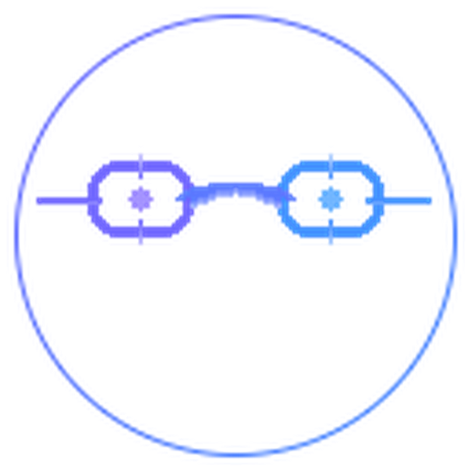
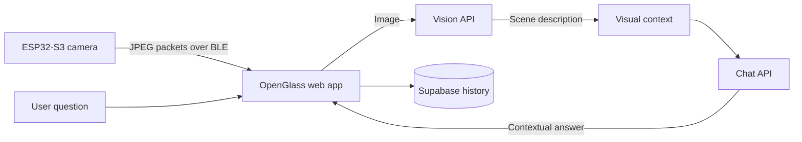

<p align="center">
  <a href="https://github.com/rahulcvwebsitehosting/OpenGlass">
    
  </a>
</p>

<h1 align="center">OpenGlass AI</h1>

<p align="center">
  <strong>Affordable smart glasses with live AI vision, searchable memories, and contextual answers.</strong><br>
  Built by <a href="https://github.com/rahulcvwebsitehosting">Rahul Shyam</a> as an open, hackable hardware and software project.
</p>

<p align="center">
  <a href="https://rahulshyam-portfolio.vercel.app/"><strong>Portfolio</strong></a> ·
  <a href="https://github.com/rahulcvwebsitehosting/OpenGlass/issues">Report a bug</a> ·
  <a href="https://github.com/rahulcvwebsitehosting/OpenGlass/issues">Request a feature</a>
</p>

## About the project

OpenGlass AI turns an inexpensive pair of glasses into a wearable visual assistant. An ESP32-S3 camera captures the scene, sends photos to the browser over Bluetooth Low Energy, and uses vision and chat models to describe what is happening and answer questions about recent captures.

The companion app also stores photos, descriptions, and question-and-answer history in Supabase, creating a searchable visual memory of the user's day.

## Highlights

- Live photo capture from the XIAO ESP32-S3 Sense over Web Bluetooth
- Automatic scene descriptions powered by a vision model
- Natural-language questions answered from recent visual context
- Photo, caption, and Q&A history backed by Supabase
- Browser-based Expo and React Native interface
- Server-side API proxies that keep model provider keys out of the client bundle
- Open Arduino firmware with camera, microphone, battery, and BLE services
- Hardware build based on readily available components

## System flow



## Technology

| Layer | Technology |
| --- | --- |
| Companion app | Expo, React Native, TypeScript |
| Device connection | Web Bluetooth / BLE |
| Hardware | Seeed Studio XIAO ESP32-S3 Sense |
| Firmware | Arduino C++ and ESP32 camera libraries |
| AI integration | OpenAI-compatible vision and chat APIs |
| Storage | Supabase Database and Storage |
| Hosting | Vercel serverless functions and static web export |

## Hardware

The reference build uses:

- Seeed Studio XIAO ESP32-S3 Sense
- 3.7 V LiPo battery suitable for the enclosure
- Glasses frame or custom 3D-printed mount
- USB-C cable for flashing and development

The device firmware exposes BLE characteristics for audio, camera data, photo control, battery status, and device information.

## Getting started

### 1. Install the app

Node.js 20 or newer is recommended.

```bash
git clone https://github.com/rahulcvwebsitehosting/OpenGlass.git
cd OpenGlass
npm install
```

### 2. Configure environment variables

Copy `.env.template` to `.env` and add your service credentials:

```env
EXPO_PUBLIC_SUPABASE_URL=
EXPO_PUBLIC_SUPABASE_ANON_KEY=

VISION_API_KEY=
VISION_BASE_URL=https://api.groq.com/openai/v1
VISION_MODEL=llama-3.2-11b-vision-preview

CHAT_API_KEY=
CHAT_BASE_URL=https://integrate.api.nvidia.com/v1
CHAT_MODEL=meta/llama-3.2-90b-vision-instruct
```

`VISION_API_KEY` and `CHAT_API_KEY` are used only by the serverless functions under `api/`. Keep provider secrets out of variables prefixed with `EXPO_PUBLIC_`.

### 3. Run the web app

```bash
npm start
```

Open the local Expo web URL in desktop Chrome or Edge. Web Bluetooth requires a supported browser and a secure context.

### 4. Flash the glasses firmware

Open `firmware/firmware.ino` in Arduino IDE, select **XIAO ESP32S3**, enable **OPI PSRAM**, and upload the sketch. Command-line build instructions are available in [`firmware/readme.md`](firmware/readme.md).

## Commands

| Command | Purpose |
| --- | --- |
| `npm start` | Start the Expo development server |
| `npm run web` | Start the web version |
| `npm run android` | Build and run the Android project |
| `npm run ios` | Build and run the iOS project |
| `npm run build:web` | Export the production web bundle |
| `npm run prompts` | Generate the image-description prompt results |

## Project structure

```text
api/                 Serverless vision and chat proxies
assets/              App icons and splash assets
firmware/            ESP32-S3 camera, microphone, and BLE firmware
prompts/             Image-description evaluation fixtures
public/              Static web assets
sources/agent/       Photo processing and contextual Q&A logic
sources/app/         Live device and capture-history interfaces
sources/modules/     Bluetooth, image, and audio helpers
sources/utils/       Shared asynchronous and encoding utilities
App.tsx              Expo application entry point
vercel.json          Web deployment configuration
```

## Deployment

The web app is configured for Vercel through `vercel.json`.

| Setting | Value |
| --- | --- |
| Install command | `npm install` |
| Build command | `npm run build:web` |
| Output directory | `dist` |

Add the environment variables from `.env.template` to the Vercel project before deploying.

## Contributing

Bug reports and focused pull requests are welcome. Use the [issue tracker](https://github.com/rahulcvwebsitehosting/OpenGlass/issues) for reproducible bugs and feature ideas.

## License

This project is distributed under the MIT License. See [`LICENSE`](LICENSE) for the complete terms.

## Connect

Designed and engineered by **Rahul Shyam**.

[](https://rahulshyam-portfolio.vercel.app/)
[](https://github.com/rahulcvwebsitehosting)
[](https://www.linkedin.com/in/rahulshyamcivil/)
[](https://x.com/RahulShyamCv)
[](mailto:rahulshyamcv@gmail.com)

<div align="center">
  <sub>© 2026 Rahul Shyam. Built from hardware to cloud.</sub>
</div>
